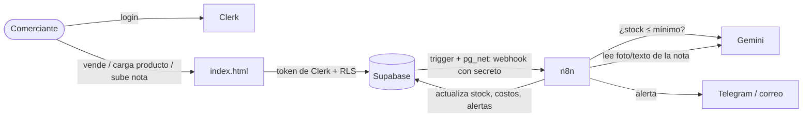

# Monitor Inteligente de Precios y Stock (POS ligero)

Comerciantes de Santa Cruz que llevan sus ventas por Telegram inician sesión con **Clerk**, registran ventas y suben notas de compra (texto o foto) a **Supabase**. **n8n** recibe cada cambio por webhook, revisa si el stock bajó del mínimo, le pide a **Gemini** una recomendación de reposición y le avisa al dueño por **Telegram** o **correo**.

## Cómo funciona



- **Venta registrada** → un trigger descuenta el stock → otro trigger avisa a n8n → si `stock ≤ stock_minimo`, Gemini mira las ventas de los últimos 30 días y los costos, recomienda cuánto reponer y n8n te lo manda.
- **Nota de compra** → n8n baja la foto, Gemini la lee y relaciona cada renglón con tus productos → se suma el stock, se actualiza el costo, queda el historial y te avisa si algún costo subió 10% o más.
- **Seguridad**: cada comerciante ve sólo sus datos (RLS con el `sub` del token de Clerk). El webhook de n8n rechaza cualquier aviso que no traiga el secreto compartido.

## Archivos

| Archivo | Qué es |
|---|---|
| `01_supabase.sql` | Tablas, seguridad, triggers, funciones y bucket de fotos. Se corre una vez en Supabase. |
| `02_n8n_workflow.json` | El workflow para importar en n8n (22 nodos). |
| `index.html` | La app web: login, inventario, ventas, notas de compra, alertas. |

---

## Paso 1 · Crear Supabase (10 min)

1. Entrá a [supabase.com](https://supabase.com), creá un proyecto (región São Paulo es la más cercana) y guardá la contraseña de la base.
2. **SQL Editor → New query**: pegá todo `01_supabase.sql` y tocá **Run**. Tiene que terminar sin errores rojos.
3. Andá a **Project Settings → Data API / API Keys** y anotá:
   - **Project URL** (`https://xxxx.supabase.co`)
   - **Publishable key** (o `anon`): va en la página web.
   - **service_role** (pestaña *Legacy API keys*; si no la tenés, la *Secret key*): va **sólo** en n8n. Nunca en la página.

## Paso 2 · Crear Clerk y conectarlo con Supabase (15 min)

1. Entrá a [dashboard.clerk.com](https://dashboard.clerk.com), creá una aplicación y elegí cómo inician sesión (correo, Google…).
2. En **API keys** copiá la **Publishable key** (`pk_test_...`).
3. Abrí la página de integración con Supabase de Clerk (**Integrations → Supabase**, o el asistente de "Connect with Supabase") y tocá **Activate Supabase integration**. Esto agrega `"role": "authenticated"` al token y te muestra tu **Clerk domain** (`algo.clerk.accounts.dev`). Copialo.
4. En Supabase: **Authentication → Sign In / Providers → Third Party Auth → Add provider → Clerk**, pegá el dominio y guardá.

Con esto, Supabase acepta el token de Clerk y `auth.jwt()->>'sub'` es el id de cada comerciante.

## Paso 3 · Bot de Telegram y clave de Gemini (10 min)

1. **Telegram**: hablale a **@BotFather**, mandá `/newbot`, elegí nombre y copiá el **token**. Abrí tu bot y mandale `/start` (si no, el bot no te puede escribir).
2. Tu **Chat ID**: escribile a **@userinfobot** y copiá el número.
3. **Gemini**: en [aistudio.google.com](https://aistudio.google.com) → **Get API key** → creá una clave.

## Paso 4 · Importar el workflow en n8n (20 min)

1. En n8n: **Create workflow → ⋯ → Import from file** → `02_n8n_workflow.json`.
2. Creá tres credenciales y asignalas:
   - **Supabase API** (Host = Project URL, Service Role Secret = la secret key) → en los nodos *Datos del producto*, *Guardar alerta*, *Datos de la compra*, *Descargar foto*, *Aplicar compra*, *Marcar compra con error*.
   - **Google Gemini(PaLM) API** (la clave de AI Studio) → en *Gemini: recomendación* y *Gemini: leer nota*.
   - **Telegram API** (token del bot) → en *Avisar por Telegram*.
   - (Opcional) **Gmail OAuth2** → en *Avisar por correo*. Si no lo usás, desactivá ese nodo.
3. Abrí el nodo **Configuración** y cambiá:
   - `secreto`: inventá una frase larga (ej. `tienda-scz-9f3k2-x7q`).
   - `supabase_url`: tu Project URL, sin barra final.
   - `modelo_gemini`: dejalo como está salvo que Google lo renombre.
4. **Publish** el workflow y copiá la **Production URL** del nodo **Aviso de Supabase** (termina en `/webhook/monitor-stock`).
5. Volvé a Supabase → SQL Editor y corré, con tus valores:

   ```sql
   update privado.config_n8n
      set url = 'https://TU-N8N/webhook/monitor-stock',
          secreto = 'tienda-scz-9f3k2-x7q'   -- el mismo del nodo Configuración
    where id = 1;
   ```

Desde ahora, cada cambio de stock y cada nota de compra le llega a n8n.

## Paso 5 · Correr la página (5 min)

1. Abrí `index.html` en tu editor y completá arriba del script: `PUBLISHABLE_KEY` (Clerk), `SUPABASE_URL` y `SUPABASE_KEY` (la publishable/anon, **no** la secreta).
2. Serví la carpeta (no la abras con doble clic):

   ```bash
   python -m http.server 5500
   # o: npx serve -l 5500
   ```

3. Abrí `http://localhost:5500`, registrate y andá a **Mi negocio**: poné el nombre, tu correo y tu Chat ID de Telegram.

## Paso 6 · Probar el circuito completo

1. **Inventario**: agregá "Coca-Cola 2 L", precio 15, costo 10, stock 6, mínimo 5.
2. **Registrar venta**: vendé 2. El stock queda en 4 (≤ 5).
3. En segundos te llega a Telegram: *⚠️ Stock bajo: Coca-Cola 2 L… 💡 Recomendación: …*. En n8n → **Executions** ves la ejecución; en la app → **Alertas** queda guardada.
4. **Nota de compra**: escribí *"compré 12 cocas de 2 litros a 11 Bs"* (o subí la foto de la factura). Tocá **Actualizar**: el stock sube a 16, el costo pasa a 11 y te llega el resumen con *▲ +10% ⚠️*.
5. Probá vender más de lo que hay: la app muestra "Stock insuficiente".

## Si algo falla

| Lo que ves | Qué probar |
|---|---|
| La app dice `No pude conectar con Supabase` o no ves tus productos | Falta el paso 2.3–2.4 (integración Clerk ↔ Supabase), o pusiste la clave equivocada en `SUPABASE_KEY`. |
| No aparece la pantalla de login | `PUBLISHABLE_KEY` mal copiada, o abriste el archivo con doble clic. |
| Vendo y n8n no recibe nada | Revisá `privado.config_n8n` (URL de **producción**, workflow **publicado**). En Supabase podés ver los intentos con `select * from net._http_response order by created desc limit 5;` |
| n8n dice "el secreto no coincide" | El `secreto` del nodo Configuración y el de `privado.config_n8n` tienen que ser idénticos. |
| Gemini da error 404 de modelo | Cambiá `modelo_gemini` por uno de la lista de modelos de Google (por ejemplo `gemini-3.5-flash-lite`). |
| Telegram da "chat not found" | No le mandaste `/start` a tu bot, o el Chat ID está mal en **Mi negocio**. |
| Una nota queda en `pendiente` | Mirá la ejecución en n8n. Si quedó en `error`, Gemini no la pudo leer: probá con texto más claro o una foto con más luz. |
| No llega una segunda alerta del mismo producto | Es a propósito: espera `horas_entre_alertas` (12 h) salvo que el stock llegue a 0. |

## Cómo presentarlo en la demo

1. **El problema**: "Doña Rosa anota sus pedidos en Telegram y se entera de que no tiene Coca cuando el cliente ya la pidió. Y no sabe que su proveedor le subió el precio."
2. **La solución**: login con Clerk, datos en Supabase protegidos por persona, n8n vigila cada cambio y Gemini da la recomendación.
3. **En vivo**: registrá una venta → mostrá el mensaje de Telegram llegando → subí una foto de una nota real → mostrá cómo sube el stock y aparece la variación de costo.
4. **Muestra la seguridad**: abrí la app con otra cuenta y no ve nada de la primera.

## Ideas para sumar

- **Ventas desde Telegram**: un segundo workflow con **Telegram Trigger** que reciba "vendí 3 cocas", le pida a Gemini el producto y la cantidad, e inserte en `ventas` con la service key. Así la gente no tiene que cambiar de hábito.
- **Resumen semanal**: un **Schedule Trigger** los lunes que mande lo más vendido y los productos que conviene reponer.
- **Gráfico de costos**: la tabla `costos_historial` ya guarda cada precio de compra; se puede graficar en la app.
